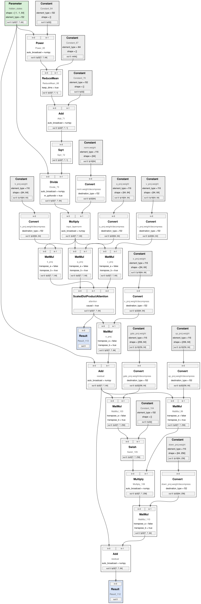
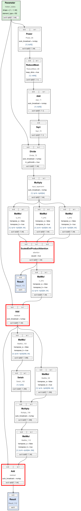

# Model Graph Visualization with Transformation Passes

A small Python library and command-line tool that turns an OpenVINO model into a
readable SVG graph. It loads the model, converts it into a framework-independent
graph, applies a configurable sequence of **transformation passes** that simplify or
annotate the drawing, and renders the result with Graphviz.

```
 Model loading  ──►  Graph construction  ──►  Transformation passes  ──►  Rendering
 (OpenVINO IR)       (mgv.graph.Graph)        (ordered, configurable)     (Graphviz → SVG)
 mgv/parsers/        mgv/graph.py             mgv/passes/                 mgv/render/
```

Passes included:

| Pass | What it does |
|---|---|
| `highlight` | Gives nodes with the given names a red border (brief 3.3.1). |
| `hide-constants` | Hides Constant nodes and shows them on their consumers as `[1]: fp32[1024, 768]`, with `(shared: <id>)` for shared constants (brief 3.3.2). |
| `fold-converts` | *Custom.* Removes the fp16→fp32 weight-decompression `Convert` ops that an fp16 export puts in front of every weight (388 of them in TinyLlama). |
| `detach-fanout` | *Custom.* Replaces edges from tensors used by many layers (attention mask, RoPE tables, `beam_idx`) with small reference tags next to each consumer. |

Contents: [Getting started](#getting-started) · [Usage](#usage) · [Examples](#examples) ·
[Architecture](#architecture) · [Extensibility](#extensibility) · [Testing](#testing) ·
[Performance](#performance) · [Known limitations](#known-limitations)

---

## Getting started

Requirements: Python 3.10+, and Graphviz (the `dot` program) on your PATH.

```bash
# 1. Graphviz system package (provides `dot`)
sudo apt install graphviz            # macOS: brew install graphviz

# 2. Clone and install the Python dependencies
git clone https://github.com/peterk05/model-graph-viz.git
cd model-graph-viz
python -m venv .venv && source .venv/bin/activate
pip install -r requirements.txt      # openvino, graphviz, numpy, pytest
# optional: pip install -e .         # also adds a `model-graph-viewer` command

# 3. Try it on a small example model that is already in the repository
python model_graph_viewer.py \
    --model examples/models/mini_attention/mini_attention.xml \
    --output graph.svg --passes hide-constants
# open graph.svg in a web browser
```

To reproduce the TinyLlama examples, export the model (about 2.2 GB, not committed)
and regenerate everything:

```bash
bash scripts/export_tinyllama.sh          # optimum-cli export, exactly as in the brief
python scripts/build_example_models.py    # rebuilds the two small example models
python scripts/make_examples.py           # all SVGs in examples/ + the benchmark table below
```

## Usage

### Command line

```bash
# No transformations
python model_graph_viewer.py --model model.xml --output graph.svg

# Passes run in exactly the order given
python model_graph_viewer.py --model model.xml --output simplified.svg \
    --passes fold-converts,hide-constants,detach-fanout

# Pass-specific options: --pass-option PASS.KEY=VALUE (repeatable)
python model_graph_viewer.py --model model.xml --output highlighted.svg \
    --passes hide-constants,highlight \
    --pass-option highlight.names=q_proj,attention \
    --pass-option highlight.color=red

# See every pass and its options
python model_graph_viewer.py --list-passes
```

| Option | Meaning |
|---|---|
| `--model PATH` | Model to load (`.xml`; the `.bin` must be next to it). |
| `--output PATH` | SVG file to write. |
| `--passes a,b,c` | Passes to apply, in this order. Leave out for no transformations. A pass not listed is disabled. |
| `--pass-option PASS.KEY=VALUE` | Configure a selected pass (see below). |
| `--edge-labels` | Also print dtype/shape on every edge (good for small graphs, slow for big ones). |
| `--save-dot` | Also save the Graphviz `.dot` source next to the SVG. |
| `--list-passes` | List passes and options, then exit. |

Pass options:

| Option | Default | Meaning |
|---|---|---|
| `highlight.names` | (required, or `names-file`) | Comma-separated node names. Every node with a matching name is highlighted (names may repeat in a model). |
| `highlight.names-file` | | Text file with one node name per line. |
| `highlight.color` | `red` | Border colour (Graphviz colour name or `#rrggbb`). |
| `hide-constants.keep-for` | `Result` | Op types whose constant inputs stay visible. |
| `fold-converts.types` | `Convert` | Op types to fold when their only input is a constant. |
| `detach-fanout.min-uses` | `8` | Detach an output used by at least this many consumer inputs. |

Errors are reported in one line with exit code 1, for example
`error: model file not found: 'model.xml'`,
`error: unknown pass 'hide-constant' (available: detach-fanout, fold-converts, hide-constants, highlight)`,
`error: weights file not found: 'model.bin' (an OpenVINO IR model needs the .bin file next to the .xml file)`.
Names given to `highlight` that match no node produce a warning.

### Python API

```python
from mgv import visualize, HideConstantsPass, HighlightNodesPass

# One call: load, transform, render, and time every stage
report = visualize(
    "model.xml", "graph.svg",
    passes=[HideConstantsPass(), HighlightNodesPass(["attention"])],
)
print(report.summary())
```

Each step on its own:

```python
from pathlib import Path
from mgv import (load_model, Pipeline, GraphvizRenderer,
                 FoldConstantConvertsPass, HideConstantsPass, create_pass)

graph = load_model("model.xml")                    # framework-independent Graph
print(graph)                                       # Graph(3168 nodes, 3741 edges)

pipeline = Pipeline([
    FoldConstantConvertsPass(),
    HideConstantsPass(keep_for=["Result"]),
    create_pass("highlight", {"names": "q_proj,k_proj"}),   # same options as the CLI
])
simplified = pipeline.run(graph)                   # `graph` itself is not changed

GraphvizRenderer(show_edge_labels=False).render(simplified, Path("out.svg"))
```

The `Graph` can also be built by hand, which is how the unit tests test passes
without any model file:

```python
from mgv import Graph
g = Graph()
x = g.add_node("x", "Parameter", role="input")
w = g.add_node("w", "Constant", role="constant")
mm = g.add_node("mm", "MatMul")
g.add_edge(x.id, 0, mm.id, 0, shape=["?", "1024"], dtype="fp32")
g.add_edge(w.id, 0, mm.id, 1, shape=["1024", "768"], dtype="fp32")
```

## Examples

Three OpenVINO models, each rendered with several pass combinations. All SVGs open
in a browser (hover an edge to see its tensor type).

| Model | Why it is included | SVGs |
|---|---|---|
| **TinyLlama-1.1B-Chat-v1.0** (fp16 export) | The large real-world model from the brief: 3,168 ops, 3,741 edges. | [`examples/tinyllama/`](examples/tinyllama/) |
| **mini_attention** (built in code) | One Llama-style decoder block: fp16 weights + decompression Converts, `ScaledDotProductAttention`, dynamic `[?, ?, 64]` shapes, two outputs, two nodes with the same name. | [`examples/mini_attention/`](examples/mini_attention/) |
| **small_cnn** (built in code) | Convolutions, a `Split` with two outputs, branches joined by `Concat`, a constant shared by two consumers, and `Add(x, x)` (two edges between the same nodes). | [`examples/small_cnn/`](examples/small_cnn/) |

The two small models are created by [`scripts/build_example_models.py`](scripts/build_example_models.py)
with the OpenVINO Python API and committed as normal IR files, so they need no
download. For every model:

| File | Passes |
|---|---|
| `1_original.svg` | none |
| `2_hide_constants.svg` | `hide-constants` |
| `3_highlight.svg` | `hide-constants,highlight` |
| `4_custom_passes.svg` | `fold-converts,hide-constants,detach-fanout,highlight` (TinyLlama), `fold-converts,hide-constants,highlight` (mini_attention) |

**Before** (`mini_attention/1_original.svg`, every weight is a Constant + Convert pair) and
**after** (`mini_attention/4_custom_passes.svg`, weights shown on the MatMuls as
`[1]: fp16→fp32[64, 64]`):

<p>

&nbsp;&nbsp;

</p>

### Custom passes: what problem they solve in TinyLlama

Looking at TinyLlama in Netron shows two separate problems:

1. **Weight decompression clutter.** The fp16 export stores every weight as
   `Constant (fp16) → Convert (to fp32) → MatMul`. That is 388 `Convert` boxes. The
   required `hide-constants` pass cannot remove them, because the Constant's consumer is
   the Convert, so the Convert stays on screen in front of every MatMul.
   **`fold-converts`** connects each such constant directly to the Convert's consumers
   (same input port) and records both types on the edge, so after `hide-constants` the
   MatMul reads `[1]: fp16→fp32[2048, 2048]`. Run it *before* `hide-constants`.

2. **A curtain of long edges.** Six tensors are computed once and used by all 22 decoder
   layers: the RoPE sin/cos tables (`Unsqueeze` ×2), the attention mask (`Select`),
   `beam_idx`, the KV-cache `Gather`, and a shape `Concat`. That is 242 edges running from
   the top of the graph down through every layer, which hides the per-layer structure.
   **`detach-fanout`** replaces each of those edges with a small dashed tag next to the
   consumer, e.g. `↳ Unsqueeze #812 out 0`. The `#812` is the source node's unique id, so
   it can still be traced, and the source node notes `out 0: 44 uses shown as ↳ #812
   references`. Each layer then appears as its own compact block.

Together with `hide-constants` this takes TinyLlama from 3,168 nodes / 3,741 edges to
about 1,770 nodes (including about 240 small reference tags) / 2,025 edges. Every
decoder layer becomes a self-contained block, and Graphviz renders it much faster
(see [Performance](#performance)).

## Architecture

```
mgv/
├── graph.py                 Graph, Node, Edge: the framework-independent representation
├── parsers/
│   ├── base.py              ModelParser interface, extension registry, load_model()
│   └── openvino_parser.py   OpenVINO IR → Graph (the only module that imports openvino)
├── passes/
│   ├── base.py              TransformationPass interface, pass registry, create_pass()
│   ├── highlight.py         highlight
│   ├── hide_constants.py    hide-constants
│   ├── fold_converts.py     fold-converts   (custom)
│   └── detach_fanout.py     detach-fanout   (custom)
├── render/
│   ├── base.py              Renderer interface
│   └── graphviz_renderer.py Graph → DOT (HTML-like labels with port cells) → SVG
├── pipeline.py              Pipeline (ordered passes) and visualize() with stage timing
└── cli.py                   argparse CLI, built only on the public API
model_graph_viewer.py        CLI entry point
```

### The intermediate graph

* **`Node`**: unique integer `id` (separate from `name`, because names can repeat),
  `name`, `type` (the op type, e.g. `MatMul`), `role` (`input`, `output`, `constant`,
  `op`, or `reference`), `attrs` (operation attributes as strings), optional port
  counts, and `viz`, a dict of visualization metadata written by passes
  (`border_color`, `input_annotations`, `notes`).
* **`Edge`**: unique `id`, `src` node + `src_port` (output index), `dst` node +
  `dst_port` (input index), and the tensor `shape` and `dtype`, either of which may be
  `None` when unknown. Dynamic dimensions are kept as `"?"` (or a range like `"1..10"`),
  and an unknown rank is `shape=None`.
* **`Graph`**: `nodes` (id → Node), `edges` (id → Edge), and two index tables,
  `in_edges` / `out_edges` (node id → edge ids).

### Key design decisions

* **Port-to-port edges with their own ids.** An edge is not "A feeds B" but "output *k*
  of A feeds input *j* of B". Because each edge has its own id, `Add(x, x)` is two distinct
  edges, and multi-output ops such as `Split` keep every output separate.
* **Index tables for O(1) neighbour lookups.** `in_edges` / `out_edges` let a pass ask
  "what feeds this node?" without scanning all edges. Every pass is linear in the size of
  the graph, so there are no repeated searches over all nodes or edges.
* **Roles instead of framework type names.** The parser maps framework-specific types to
  roles (OpenVINO `Constant` → `constant`, `Parameter` → `input`, `Result` → `output`).
  `hide-constants` checks `role == "constant"`, so an ONNX parser that maps initializers
  to the `constant` role works with it unchanged.
* **Data types normalised by the parser** (`f32` → `fp32`, `i64` → `int64`), so labels match
  the brief (`fp32[1024, 768]`) and nothing downstream sees OpenVINO's naming.
* **The original model is never modified.** The parser only reads from OpenVINO and copies
  plain values (strings and ints) into the graph. Passes never see OpenVINO objects.
  Constant *values* are never read or copied, only their type and shape.
* **One copy, not one per pass.** `Pipeline.run()` copies the input graph once, then every
  pass edits that copy in place. The caller's graph stays unchanged, and memory use stays
  at one extra graph however many passes run. `visualize()` skips even that copy, because
  the freshly parsed graph is not used anywhere else.
* **Visualization metadata, not new graph fields.** Passes record what to *show* in
  `node.viz`. The renderer reads it, and nothing else depends on it.
* **The renderer handles any op type.** Styling is chosen by role, with a neutral default
  for everything else, so op types never seen before still render.
* **Ports drawn as table cells.** Each node is an HTML-like Graphviz table with one cell per
  input port at the top and per output port at the bottom, and edges attach to the
  exact cells (`n5:out1 -> n9:in0`). The output cell also shows the tensor type
  (`out 0: fp32[?, ?, 2048]`), and every edge has it as a hover tooltip.

## Extensibility

### Add a transformation pass

Create a class, give it a `name`, implement `apply`, and register it. The parser,
renderer and CLI pick it up automatically (it appears in `--list-passes`, and its
options work through `--pass-option`).

```python
# mgv/passes/hide_type.py
from mgv.graph import Graph
from mgv.passes.base import TransformationPass, register_pass

@register_pass
class HideTypePass(TransformationPass):
    name = "hide-type"
    description = "Remove every node of one op type."
    option_help = {"type": "op type to remove"}

    def __init__(self, op_type: str) -> None:
        self.op_type = op_type

    def apply(self, graph: Graph) -> Graph:
        for node in graph.of_type(self.op_type):
            graph.remove_node(node.id)       # also removes its edges
        return graph

    @classmethod
    def from_options(cls, options: dict[str, str]) -> "HideTypePass":
        cls.check_option_names(options)
        return cls(options["type"])
```

Then import it in `mgv/passes/__init__.py` so it registers when the package loads.

### Support another model format

Write a parser that produces a `Graph` and register it for its file extension.
`load_model()`, the CLI, every pass and the renderer then accept the new format, with
no changes to them.

```python
# mgv/parsers/onnx_parser.py (sketch)
from pathlib import Path
from mgv.graph import Graph
from mgv.parsers.base import ModelParser, register_parser

@register_parser
class ONNXParser(ModelParser):
    extensions = (".onnx",)
    format_name = "ONNX"

    def parse(self, path: Path) -> Graph:
        import onnx
        model = onnx.load(str(path))
        graph = Graph(name=path.stem)
        # graph inputs -> role="input"; initializers -> role="constant";
        # nodes -> add_node(node.name, node.op_type, attrs);
        # connect tensor producers to consumers with add_edge(src, out_index, dst, in_index, shape, dtype)
        ...
        return graph
```

### Another renderer

Implement `mgv.render.base.Renderer.render(graph, output_path)` (for example a JSON
or Mermaid exporter) and pass it to `visualize(..., renderer=MyRenderer())`.

## Testing

```bash
pip install -r requirements.txt
python -m pytest          # or: python -m pytest -v
```

65 tests, all running in a couple of seconds. None of them needs TinyLlama or a network
connection: synthetic graphs are built in code, and the tiny OpenVINO model for the
parser and end-to-end tests is generated into a temporary folder by
`tests/conftest.py`.

| File | Covers (brief section 4) |
|---|---|
| `tests/test_graph.py` | Node/edge creation, unique ids vs duplicate names, port indices, multiple outputs and fan-out, parallel edges between the same nodes, dynamic and missing shapes, removal keeps the graph valid, independent copies, `validate()` |
| `tests/test_parser.py` | OpenVINO → Graph: op types, roles, connections and port indices (including `Add(x, x)` and `Split` outputs), dynamic dims, dtypes, attributes without constant values, clear errors for missing / unsupported / weightless / corrupt files |
| `tests/test_passes.py` | Highlight (only matching nodes, duplicate names, unmatched names). Hide-constants (single consumer, shared constants with ids, port preserved, unrelated and parallel edges preserved, constant kept while it has a visible edge, missing metadata). Both custom passes. Option parsing and errors. |
| `tests/test_pipeline.py` | Order of execution, input graph untouched, combined passes give a valid graph, order-dependent results, per-pass timing |
| `tests/test_render.py` | Well-formed SVG with one node/edge group per graph node/edge, port cells and port-to-port edges, attributes, red border only on highlighted nodes, hidden-constant annotations, reference tags, unknown op types and escaping, edge labels option, large-graph layout setting |
| `tests/test_end_to_end.py` | Tiny OpenVINO model → passes → SVG through the Python API, the CLI (with and without passes, options, warnings, errors) and the `model_graph_viewer.py` script |
| `tests/test_scalability.py` | Passes and DOT generation on a synthetic 5,400-node transformer-like graph within a time limit |

## Performance

`scripts/make_examples.py` measures the three main stages for every example
(`visualize()` returns the same numbers as a `VisualizationReport`), writes them to
[`examples/benchmark.md`](examples/benchmark.md), and updates the table below.

<!-- BENCHMARK:START -->
**Test environment:** Linux 7.0.0-38-generic | CPU: AMD Ryzen 7 6800HS with Radeon Graphics (16 threads) | RAM: 14.3 GB | Python 3.14.4 | OpenVINO 2026.4.1-22982-e213a147257-releases/2026/4 | dot - graphviz version 14.1.2 (0) | graphviz (Python) 0.21

| Model | Passes | Nodes / edges before | Nodes / edges after | Load + build graph (s) | Passes (s) | Render SVG (s) |
|---|---|---|---|---|---|---|
| small_cnn | (none) | 27 / 29 | 27 / 29 | 0.13 | 0.000 | 0.02 |
| small_cnn | hide-constants | 27 / 29 | 16 / 17 | 0.00 | 0.000 | 0.02 |
| small_cnn | hide-constants,highlight | 27 / 29 | 16 / 17 | 0.00 | 0.000 | 0.02 |
| mini_attention | (none) | 41 / 46 | 41 / 46 | 0.00 | 0.000 | 0.02 |
| mini_attention | hide-constants | 41 / 46 | 29 / 34 | 0.00 | 0.000 | 0.02 |
| mini_attention | hide-constants,highlight | 41 / 46 | 29 / 34 | 0.00 | 0.000 | 0.02 |
| mini_attention | fold-converts,hide-constants,highlight | 41 / 46 | 21 / 26 | 0.00 | 0.000 | 0.02 |
| tinyllama | (none) | 3168 / 3741 | 3168 / 3741 | 0.14 | 0.000 | 617.13 |
| tinyllama | hide-constants | 3168 / 3741 | 1911 / 2429 | 0.11 | 0.003 | 63.36 |
| tinyllama | hide-constants,highlight | 3168 / 3741 | 1911 / 2429 | 0.11 | 0.002 | 67.44 |
| tinyllama | fold-converts,hide-constants,detach-fanout,highlight | 3168 / 3741 | 1770 / 2025 | 0.12 | 0.004 | 0.48 |
<!-- BENCHMARK:END -->

### Where the time goes, and what I changed because of it

* **Parsing and passes are fast.** Building the 3,168-node TinyLlama graph and running
  every pass is linear in nodes + edges. On a synthetic 5,400-node graph
  (`tests/test_scalability.py`) all four passes together take a few hundredths of a
  second.
* **Graphviz layout is the bottleneck.** Measured during development on the TinyLlama
  graph (Graphviz 2.43, 2-core cloud VM):
  * With dtype/shape as **edge labels**, `dot` had not finished the simplified graph
    after 10 minutes: every edge label becomes an extra node in Graphviz's layout.
    The tensor types moved to the **output-port cells** and to **edge tooltips** instead.
  * `dot -v` showed the remaining time going to the horizontal positioning step (a
    network-simplex problem over ~157,000 helper nodes created by long edges). For graphs
    over 500 nodes the renderer sets `nslimit=1`, which caps that step for a slightly
    less tidy layout: about **38 s** for `fold-converts,hide-constants` and about **110 s**
    for the untransformed graph.
  * The long edges themselves came from the six tensors shared by all 22 layers. Removing
    them with **`detach-fanout`** brought the same render down to about **1 s**, and made
    the picture readable.
* **Memory:** one graph copy per pipeline run (none in `visualize()`), never one per pass.
  Constant values are never loaded into the graph. OpenVINO memory-maps the `.bin` file.

## Known limitations

* **Rendering very large graphs is slow.** Graphviz `dot` is the bottleneck (minutes for
  the unsimplified TinyLlama). Possible improvements: render a sub-graph (e.g. one decoder
  layer, selected by a pass), collapse repeated layers into one node, or use an
  interactive, incremental web viewer for huge graphs instead of a static SVG.
* **`nslimit` trades layout quality for speed** on graphs over 500 nodes. The threshold
  is a `GraphvizRenderer` argument.
* **Only OpenVINO IR is implemented.** The parser registry is ready for more formats (see
  the ONNX sketch above).
* **Operations with sub-graphs** (`If`, `Loop`, `TensorIterator`) are drawn as single
  nodes. Their bodies are not expanded.
* **Long attribute lists and names are shortened** in labels (first 6 attributes, 48
  characters). The limits are `GraphvizRenderer` arguments.
* **`fold-converts` records the type change on the edge** as text (`fp16→fp32`). It is
  meant for visualization only and must run before `hide-constants`.
* **Node names for `highlight` must match exactly.** Pattern matching (e.g. regular
  expressions) would be a simple extension.
